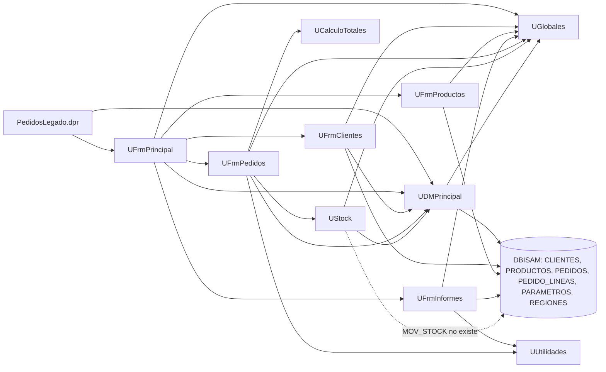

# Dependencias de Pedidos Legado

Una flecha A --> B significa «A usa a B» (según la cláusula `uses` o una consulta SQL).
La base de datos DBISAM aparece como nodo propio.

Notas:
- Los formularios de clientes, productos e informes tienen sus propias tablas o consultas DBISAM, así que acceden a la base directamente, sin pasar por `UDMPrincipal`.
- `REGIONES` no tiene componente de tabla en `UDMPrincipal`; solo se consulta por SQL desde `UFrmPedidos`.
- La flecha punteada marca una escritura a una tabla que no existe en el esquema (`UStock.pas:85`).

## Preguntas guía

1. **¿Qué unidad usan casi todas las demás? ¿Qué pasaría si cambia?**
   `UGlobales` la usan 8 de las 10 unidades (todas menos `UCalculoTotales` y `UUtilidades`). Son variables globales modificables desde varios formularios, así que un cambio ahí (por ejemplo la tasa de IVA o el usuario) afecta a todo el sistema sin que el compilador lo avise. Le sigue `UDMPrincipal`, de la que dependen 4 unidades y la conexión a la base.

2. **¿Qué unidad no depende de formularios ni de la base de datos? ¿Por qué importa para migrar?**
   `UCalculoTotales` (solo `SysUtils`) y `UUtilidades` (`SysUtils` y `DateUtils`). Son lógica pura: se pueden portar a C#/.NET primero y cubrir con pruebas unitarias sin montar pantalla ni base. `UCalculoTotales` es el mejor candidato porque concentra las reglas de precio.
