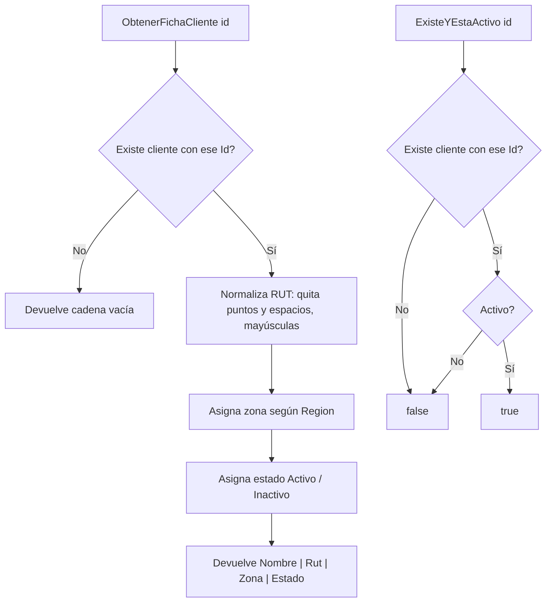

# ClientesService

Ubicación: `src/PedidosWeb.Core/Clientes/ClientesService.cs` (namespace `PedidosWeb.Core.Clientes`).

## Propósito

Servicio de dominio que consulta clientes de la distribuidora sobre una lista en memoria. Ofrece:

- La **ficha de texto** de un cliente para mostrar en pantalla.
- La comprobación de si un cliente **existe y está activo**.

Es código heredado: funciona y está cubierto por 4 tests, pero el campo interno `_l` tiene un nombre poco claro.

## API pública

### Constructores

| Firma | Descripción |
|---|---|
| `ClientesService()` | Usa los 8 clientes de `ClientesDeEjemplo.Crear()`. |
| `ClientesService(List<Cliente> l)` | Usa la lista indicada. |

### `string ObtenerFichaCliente(string id)`

Busca el cliente por `Id` (comparación exacta, distingue mayúsculas) y devuelve:

```
<Nombre> | <Rut normalizado> | <Zona> | <Estado>
```

- Si no existe el cliente, devuelve `""` (cadena vacía).
- **Rut normalizado**: se quitan los puntos y los espacios, y se pasa a mayúsculas (el guion se conserva).
- **Zona**, según `Region`:

| Region | Zona |
|---|---|
| `RM`, `V` | `Zona centro` |
| `VIII` | `Zona sur` |
| `II` | `Zona norte` |
| cualquier otra | `Sin zona` |

- **Estado**: `Activo` si `Activo` es `true`; si no, `Inactivo`.

### `bool ExisteYEstaActivo(string id)`

Devuelve `true` si existe un cliente con ese `Id` y está activo; `false` si no existe o está inactivo.

### Modelo `Cliente`

`Id`, `Nombre`, `Rut`, `Region` (todos `string`) y `Activo` (`bool`).

## Ejemplo de uso

Con los datos de ejemplo (los mismos de los tests):

```csharp
var servicio = new ClientesService();

servicio.ObtenerFichaCliente("C-001");
// "Ferretería El Clavo | 76123456-0 | Zona centro | Activo"

servicio.ObtenerFichaCliente("C-004");   // RUT original: "76.990.011-k"
// "Almacén La Esquina | 76990011-K | Zona centro | Activo"

servicio.ObtenerFichaCliente("C-999");
// ""

servicio.ExisteYEstaActivo("C-001"); // true  (activo)
servicio.ExisteYEstaActivo("C-007"); // false (inactivo)
servicio.ExisteYEstaActivo("C-999"); // false (no existe)
```

## Diagrama



## Tests

`tests/PedidosWeb.Core.Tests/Clientes/ClientesServiceTests.cs`: cliente inexistente, ficha de cliente activo, normalización del RUT (puntos y `k` minúscula) y `ExisteYEstaActivo` para activo, inactivo e inexistente.
